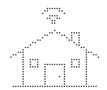

<div align="center">

<picture>
  <source media="(prefers-color-scheme: dark)" srcset="assets/icon-dark.svg">
  
</picture>

<h1>𝘿𝙤𝙢𝙪𝙨𝘾𝙤𝙣𝙩𝙧𝙤𝙡</h1>
<h3>Smart Home Automation System</h3>


*Academic project developed for **Programação Orientada aos Objetos** @ University of Minho*  
*Final grade: **16/20** ⭐*

</div>

---

## 🔌 About

For Object Oriented Programming we built a smart home system in Java that runs entirely in the terminal. You can create houses and rooms, add lamps, speakers, curtains and other devices, and control them one by one or let the house do it for you with automations, schedulings and scenarios.

The whole thing follows the **MVC** pattern, and a big part of the work was getting the class design right: what should be abstract, what should inherit from what, and how to keep the model completely separate from the menus.

---

## ⚡ What it does

- users with a different role in each house (you can be admin at home and a regular user at a friend's)
- 7 types of devices (lamps, colour lamps, speakers, curtains, garage gates, relays and sockets) and 2 sensors (rain and luminosity)
- automations that react to sensor readings
- schedulings that run at a certain hour of the day
- scenarios that control several devices at once
- usage statistics for each device: energy, activations and time on
- a simulated clock, so we could test days of use in a few minutes
- saving and loading the whole state of the app to a file
- **automatic suggestions** based on how the house is used

---

## 🧩 My part

I built the base architecture, the device hierarchy, houses and rooms, the automations, the statistics and the saving and loading of the app state, and I drew the UML diagram. The suggestion engine we built together, and I also put the report together.

---

## 💡 The fun part

My favourite feature is the suggestion engine. The app keeps a record of every interaction, and if you turn on the same lamp at around 8 pm on three different days, it notices and suggests creating a scheduling for it. It also looks for sensors and devices that tend to change together within a few minutes, and suggests an automation. You can accept or reject each suggestion.

My favourite bug: when we gave the menus colours, all the boxes around them came out crooked. The colour codes are invisible on screen, but Java still counts them as characters, so the padding was all wrong. We ended up calculating the width using only the characters you can actually see.

---

## 🚀 How to Run

```bash
# Compile
javac -d bin -sourcepath src src/Main.java

# Run
java -cp bin Main
```

The app starts with some test data already loaded. You can log in with:

| User | Password | Role |
|---|---|---|
| `u1` | `1234` | Admin |
| `u2` | `5678` | Regular |

To load the state we used in the defence, choose option **9** in the main menu and type `estado_apresentacao.bin`.

---

## 🗂️ Project Structure

```
.
├── src/
│   ├── Main.java
│   ├── controller/          # DomusController, the central hub
│   ├── model/
│   │   ├── devices/         # Device, Actuator, Sensor and every device
│   │   ├── house/           # House and Room
│   │   ├── users/           # User and Role
│   │   └── automations/     # automations, schedulings, scenarios, suggestions
│   ├── view/                # terminal menus
│   ├── exceptions/          # custom exceptions
│   └── utils/               # SimulatedClock, SuggestionEngine, TestData, UIColors
├── docs/                    # report and full UML diagram (in Portuguese)
└── estado_apresentacao.bin  # saved state for the defence
```

---

## 🛠️ Tech Stack

`Java` · `OOP` · `MVC` · `Inheritance & Polymorphism` · `Java Serialization` · `UML` · `draw.io`

---

## 👩‍💻 Authors

**Carolina Dias** · [@carolinavdias](https://github.com/carolinavdias)  
**Ana Patrícia Machado** · [@apatriciamachado](https://github.com/apatriciamachado)

<p align="center"><i>tested on a lot of imaginary lamps</i></p>
